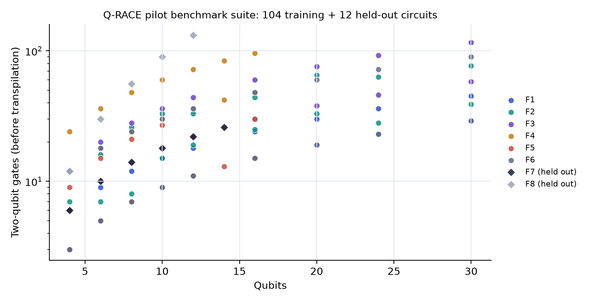

# Checkpoint 1: acceptance evidence for D1.1 and D1.2

This file records how each "done when…" condition of the Checkpoint-1 deliverables
was checked. Numbers marked *local* come from a clean Linux machine
(21 November 2026); numbers marked *CI* are filled in from the first green GitHub
Actions run after the repository is pushed.

## D1.1 Repository, CI, README, licence, pinned environment

**Done when:** CI is green; a fresh clone installs in < 15 min.

| Check | Evidence | Result |
|---|---|---|
| Package skeleton | `src/qrace` (src layout), `pyproject.toml`, console script `qrace-bench` | ✅ |
| Pinned environment, all platforms | `requirements/lock.txt`, universal lock via `uv pip compile --universal` (Python 3.11–3.13, Linux/macOS/Windows) | ✅ |
| Fresh install, no cache (*local*) | Python 3.11: 26 s · 3.12: 22 s · 3.13: 16 s (limit 900 s) | ✅ |
| Fresh install, no cache (*CI*) | job `fresh clone install (< 15 min)`, time written to the run summary | ☐ add link after first run |
| Laptop and HPC | `scripts/setup_env.sh` / `.ps1`; `env/environment.yml` (conda); `env/qrace.def` (Apptainer); `slurm/test_and_pilot_suite.sbatch` | ✅ files · ☐ HPC run log |
| CI | `.github/workflows/ci.yml`: ruff lint, tests on 3 OSes × Python 3.11–3.13, smoke-suite build + verify, timed fresh install | ☐ add link to first green run |
| README | install (laptop, Windows, HPC), quick start, benchmark overview, layout, reproducibility, citation, AI statement | ✅ |
| Licence | Apache-2.0 (`LICENSE`, declared in `pyproject.toml` and `CITATION.cff`) | ✅ |
| Repository hygiene | `CONTRIBUTING.md`, `CODE_OF_CONDUCT.md`, `CITATION.cff`, `CHANGELOG.md`, PR and issue templates, `.gitignore` blocking tokens and data | ✅ |

## D1.2 Benchmark suite F1–F8 with Clifford twins and exact ideal values

**Done when:** tests confirm ideal values against a state vector for ≤ 10 qubits.

| Check | Evidence | Result |
|---|---|---|
| Eight families implemented | `qrace.bench.families`: F1–F8 with every variant and parameter value used by the suite grids (36 settings) | ✅ |
| Exact ideal values | stabilizer (F1, F2, F6, twins), state vector (F4, F5, F7, F8), analytic (F3) | ✅ |
| **Acceptance test** (*local*) | `tests/test_ideal_values.py`: **865 tests**. All 36 family settings × n ∈ {4, 6, 8, 10} (even n only where required) × 3 seeds, for the circuits and for their Clifford twins, against an independent dense state vector, tolerance 10⁻⁹ | ✅ 865/865 pass |
| Pilot suite re-verification (*local*) | `qrace-bench verify`: 61 instances with n ≤ 10, 455 observables, max deviation 1.4 × 10⁻¹⁴ | ✅ |
| Clifford twins | same instruction count, same two-qubit gates on the same qubits, same barriers; Clifford by construction; ≥ 1 observable with ideal ±1 (`tests/test_twins.py`) | ✅ |
| Wide circuits | 30-qubit F1, F2, F6 via stabilizer route (3 instances in 0.07 s); F3 analytic values match the state vector at 16 qubits (`tests/test_wide.py`) | ✅ |
| Determinism | pilot `circuits.qpy` SHA-256 `48e15b86ebb75e05…` identical across repeated runs and across Python 3.11, 3.12, 3.13 | ✅ |
| Held-out discipline | F7, F8 (and their twins) carry `split = "heldout"` (tested) | ✅ |
| Whole test suite (*local*) | 1,147 passed, 1 skipped (by design) in 16 s; statement coverage 97 % | ✅ |

## Pilot suite (input to the D1.5 pilot dataset)



See [`pilot_summary.md`](pilot_summary.md) for the per-family table. Regenerate both
with `python scripts/make_cp1_figures.py`.

## How to reproduce this evidence

```bash
bash scripts/setup_env.sh && source .venv/bin/activate
pytest -q                                   # whole suite
pytest -q tests/test_ideal_values.py        # D1.2 acceptance test only
qrace-bench build --spec pilot --out data/bench/pilot
qrace-bench verify data/bench/pilot --max-qubits 10
sha256sum data/bench/pilot/circuits.qpy     # expect 48e15b86ebb75e05...
```
